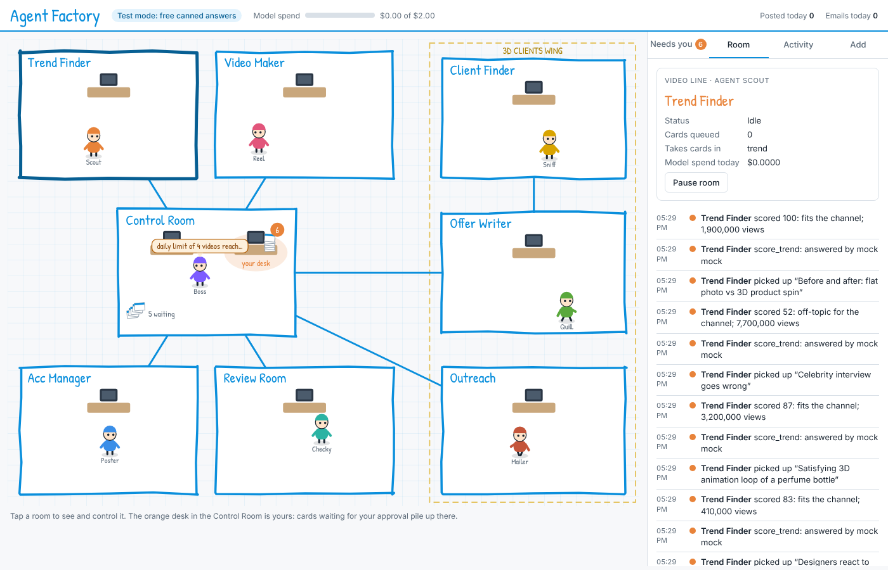

# Agent Factory

A factory where the workers are AI agents. Each room does one job, job cards move from room to room, and a game-like view shows the agents working so you can watch and control them.



## The two production lines

**Video line (YouTube Shorts and TikTok)**

| Room | What it does | Runs on |
|---|---|---|
| Trend Finder | Collects trends (YouTube API, the sample list, or ideas you drop in) and scores each one 0 to 100 for your niche | cheap model (`score_trend`) |
| Control Room | Turns down weak ideas by rule, asks a model about the rest, keeps to the daily video limit | rules + mid model (`decide`) |
| Video Maker | Writes the script, then renders a vertical MP4 with Pillow and ffmpeg | strong model (`write_script`) + local renderer |
| Review Room | Checklist: file exists, length, caption, hashtags, banned words. Sends bad drafts back once | plain code |
| **Your desk** | You watch the video and approve or reject it | you |
| Acc Manager | Prepares the YouTube Shorts and TikTok posts | plain code |

**3D clients wing**

| Room | What it does | Runs on |
|---|---|---|
| Client Finder | Reads companies from `data/prospects.csv` (or ones you add), skips bad emails, duplicates and the do-not-contact list, then opens each product page and looks for 3D (model-viewer, .glb/.usdz files, Sketchfab, three.js, AR buttons) | plain code |
| Offer Writer | Drafts a short offer for companies with no 3D, adds your name, address and an opt-out line | mid model (`write_offer`) |
| **Your desk** | You read the email and approve or reject it | you |
| Outreach | Sends approved emails within a daily cap. Its reply desk sorts replies saved in `var/inbox`: "stop" goes on the do-not-contact list, interested replies are flagged for you | plain code |

Rooms never talk to each other. Every card is a row in `var/factory.db` with a status; each room picks up cards in its status and moves them on, and every action is written to an event log. The view only draws that database.

## Run it

```bash
pip install -r requirements.txt
python -m factory
```

Open http://127.0.0.1:8000. To open it from your phone on the same Wi-Fi, run `python -m factory --host 0.0.0.0` and visit your laptop's IP address.

It starts in **test mode**: models give canned answers (free), posts are saved to `var/outbox/posts`, and emails are saved to `var/outbox/emails` as `.eml` files. Nothing leaves your laptop.

In the view: tap a room to see what it is doing and pause or resume it. Cards waiting for you pile up on the orange desk in the Control Room and in the **Needs you** tab. The **Add** tab lets you drop in a video idea or a company.

## Going live, one switch at a time

All settings are in `config.toml`. Secrets go in `.env` (copy `.env.example`).

1. **Real models.** Set `[llm] mode = "live"` and put `ANTHROPIC_API_KEY` in `.env`. Each task has its own model under `[llm.tasks.*]`. `daily_budget_usd` stops all paid calls for the day once reached.
2. **Real trends.** Put a free `YOUTUBE_API_KEY` in `.env`. TikTok has no free public trends API, so TikTok trends come in through the **Add** tab for now.
3. **Real emails.** Fill in `[outreach]` with your real name, business and postal address, add SMTP settings to `.env`, then set `[outreach] live = true`. Keep `daily_cap` low at first.
4. **Real posting.** Not connected yet. Uploading needs the YouTube Data API with OAuth and TikTok's Content Posting API, which requires TikTok to approve your app. Until then, upload the files from `var/outbox/posts` yourself.

## Running models on your own GPU (RTX 5060, 8 GB)

Install [Ollama](https://ollama.com), then for example `ollama pull qwen2.5:7b` or `ollama pull llama3.1:8b`. In `config.toml`, point a task at it:

```toml
[llm.tasks.score_trend]
provider = "ollama"
model = "qwen2.5:7b"
```

8 GB of graphics memory fits models of about 7 to 8 billion parameters comfortably. That is plenty for scoring trends, and I would keep script and email writing on a hosted model because the quality shows directly. If a model stops answering (for example Ollama is not running), the room pauses itself and tells you why; press Resume once it is fixed.

## Before sending real emails

Cold email is regulated (CAN-SPAM in the US, GDPR/PECR in the UK and EU, and others). The factory already adds your identity and an opt-out line, keeps a do-not-contact list and waits for your approval on every email. You still need to use your real details, honour every opt-out, keep volume low, and only collect contacts in ways the source platform's terms allow.

## Tests

```bash
python -m pytest
```

They run both lines end to end in test mode, plus the daily limits, the budget stop, the do-not-contact list and reply sorting.

## Not built yet

- Live upload to YouTube and TikTok (see above).
- Fetching replies from your mailbox automatically (save them into `var/inbox` for now).
- Judging *poor-quality* 3D on a page (it only detects whether 3D exists).
- Voice-over and real footage in videos. `factory/video.py` is the one file to replace.
